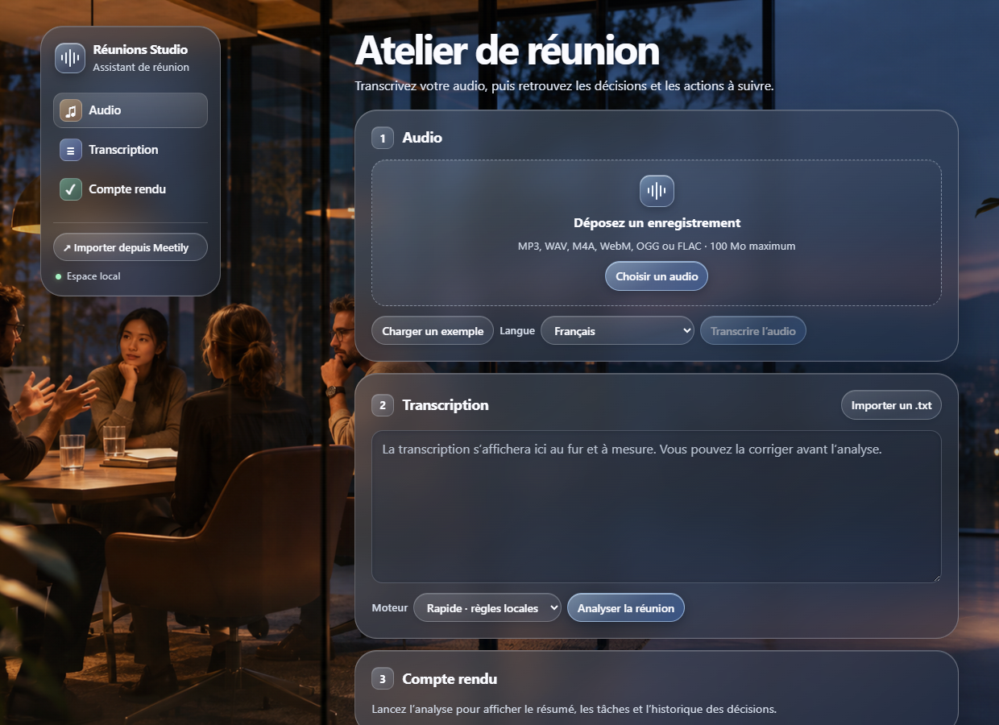

# Réunions Studio

Assistant de réunion développé par **Ismail Lahlou**. Il permet d’ouvrir une salle audio avec lien d’invitation ou d’importer un enregistrement. L’application prépare ensuite une transcription horodatée, un résumé, les décisions et les actions.

## Ce que j’ai développé

- **Salle audio indépendante.** L’hôte ouvre la page `/salle`, invite les participants par lien HTTPS et enregistre l’appel avec leur accord. **Terminer et analyser** ferme la salle, revient à l’atelier et lance le traitement local.
- **Transcription locale.** Faster Whisper affiche progressivement les passages horodatés. La transcription est modifiable avant la validation du compte rendu.
- **Décisions et actions vérifiables.** L’historique suit les dates proposées et validées. Chaque repère audio joue uniquement le passage correspondant. Les actions indiquent les responsables et les échéances disponibles.
- **Deux modes d’analyse.** Règles locales pour une réponse rapide ou Qwen via Ollama. Import de transcriptions Meetily en lecture seule et export Markdown ou JSON après validation.

Le parcours audio a été testé en français. La salle a été vérifiée entre deux sessions Chrome, avec une invitation HTTPS et une analyse déclenchée après la réunion. L’import Meetily a été vérifié sur une base de test compatible.

**Stack** · Python, Faster Whisper, Node.js, JavaScript, WebRTC, SQLite, Ollama et Qwen2.5.

## Démarrer

1. Sous Windows, extrayez le ZIP. Installez Node.js 20+ et Python 3.11 ou 3.12 si aucun moteur correspondant n’est disponible. Le lanceur détecte aussi les outils livrés avec Codex.
2. Exécutez `Installer_audio.cmd` une fois pour récupérer Faster Whisper et le modèle multilingue Whisper Base (~145 Mo pour le modèle). L’audio reste local après installation.
3. Exécutez `Lancer_Studio.cmd` et utilisez `http://127.0.0.1:8468`. Choisissez un fichier MP3, WAV, M4A, WebM, OGG ou FLAC de 100 Mo maximum, ou chargez l’exemple audio synthétique en français.
4. Cliquez sur **Transcrire l’audio**. Corrigez le texte si nécessaire, puis cliquez sur **Analyser la réunion**. Le mode à règles est immédiat. Pour **IA locale · Qwen**, Ollama doit fonctionner et `ollama list` doit contenir `qwen2.5:7b`.
5. Consultez les décisions, les tâches et leurs preuves. Cliquez sur un repère horaire pour écouter uniquement le passage correspondant. La lecture s’arrête à la fin du segment. Relisez avant de valider et d’exporter.

## Historique des décisions

Pour les sujets reconnus (livraison, démonstration, tests, budget et publication), les dates différentes sont affichées dans l’ordre. Une validation après une proposition retient sa date. Plusieurs validations incompatibles restent à vérifier, sauf correction explicite. Ce regroupement heuristique fonctionne sur des formulations explicites en français. Il exige une relecture si plusieurs décisions distinctes abordent le même sujet.

## Raccordement à Meetily

Le bouton **Importer depuis Meetily** détecte `meeting_minutes.sqlite` dans les dossiers locaux de Meetily. Il affiche les réunions et ouvre les segments choisis, sans copier-coller, via une connexion SQLite en lecture seule. Si nécessaire, indiquez le chemin exact en définissant `MEETILY_DB` avant de lancer `node server.js`. Le raccordement utilise le schéma public de Meetily Community. Pour utiliser le lecteur et les liens audio, ouvrez l’enregistrement d’origine dans Réunions Studio et lancez sa transcription.

Le système utilise un seul moteur audio à la fois. Whisper Base est multilingue. L’exactitude varie selon la langue, la qualité audio et les échanges simultanés. Corrigez le texte avant d’analyser. Les règles d’analyse ciblent les réunions en français.

## Salle audio avec lien d’invitation

Installez [cloudflared](https://developers.cloudflare.com/cloudflare-one/networks/connectors/cloudflare-tunnel/downloads/) sur le poste hôte. Fermez `Lancer_Studio.cmd` si ouvert, puis exécutez `Lancer_Salle_En_Ligne.cmd`. Ouvrez la page **Salle en ligne**, créez une salle et partagez le lien HTTPS avec les participants. Le lien est temporaire. Gardez le lanceur ouvert pendant l’appel. La salle accepte jusqu’à six participants.

Les invités autorisent leur micro et acceptent que l’hôte puisse enregistrer. L’hôte clique sur **Démarrer l’enregistrement** quand tout le monde est prêt. À la fin, **Terminer et analyser** ferme la salle, revient à l’atelier et lance la transcription puis l’analyse sur le poste hôte. Le passage de l’audio entre les deux pages utilise le stockage local temporaire du navigateur. L’hôte peut relire, valider et exporter le compte rendu.

Le tunnel sert uniquement la page d’invitation et la signalisation WebRTC. Les fichiers audio, la transcription, Meetily et le compte rendu restent locaux. L’audio de l’appel circule entre les navigateurs via WebRTC. Certains réseaux bloquent les connexions directes. Si nécessaire, configurez un relais TURN avec identifiants à durée limitée via `REUNIONS_TURN_URL`, `REUNIONS_TURN_USER` et `REUNIONS_TURN_PASSWORD`. Une infrastructure HTTPS existante peut aussi servir la passerelle d’invitation sur le port 8467 via `REUNIONS_PUBLIC_URL`.

## Références

- [Meetily Community Edition](https://github.com/Zackriya-Solutions/meetily)
- [Stockage des réunions et transcriptions Meetily](https://github.com/Zackriya-Solutions/meetily/blob/main/frontend/src-tauri/src/database/repositories/meeting.rs)
- [Faster Whisper](https://github.com/SYSTRAN/faster-whisper)

## Fond de l’interface

`meeting-wallpaper.png` a été créé avec l’outil ImageGen intégré. Prompt utilisé :

> Photorealistic editorial landscape photograph, a modern glass-walled meeting room with four colleagues seated around a walnut table collaborating, shot from outside room through glass, some silhouetted side profiles and a person gesturing. Architectural photography, cinematic natural dusk, cool deep blue twilight through large windows and warm amber lamp reflections, warm walnut and muted taupe. Wide 16:9 wallpaper composition for a premium glass UI application: major recognizable human activity and glowing practical lamp concentrated in the LEFT third and far right edges, soft lower-contrast space in center-right, enough underlying contrast and details to be visible through translucent frosted cards. Authentic candid workplace photography, refined atmospheric depth, realistic lighting, dark navy shadows, no heavy pre-applied blur. The entire image is JUST the photograph, with no letters, no logos, no screens with readable text, and no UI graphics or glass overlays drawn into the photo.
